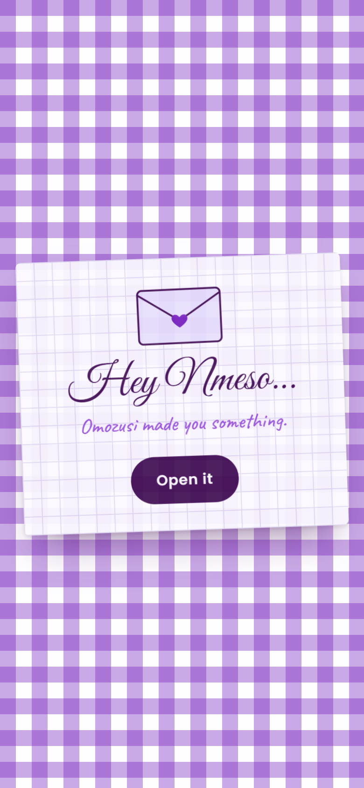
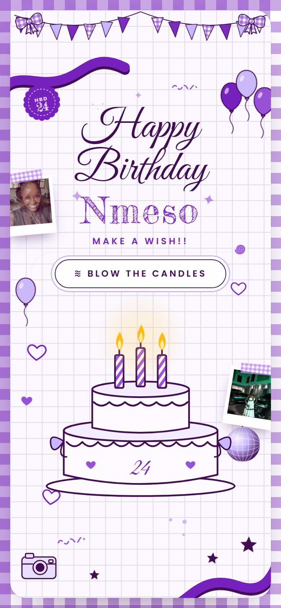
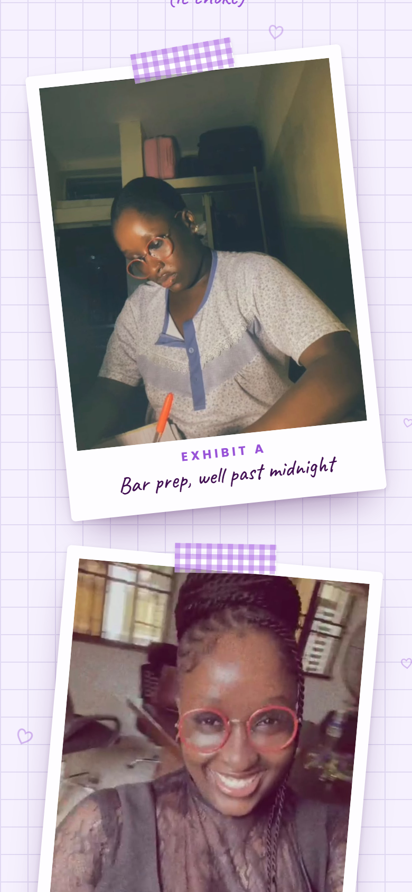
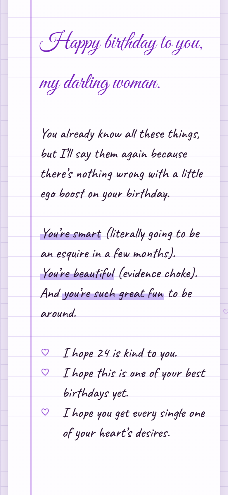
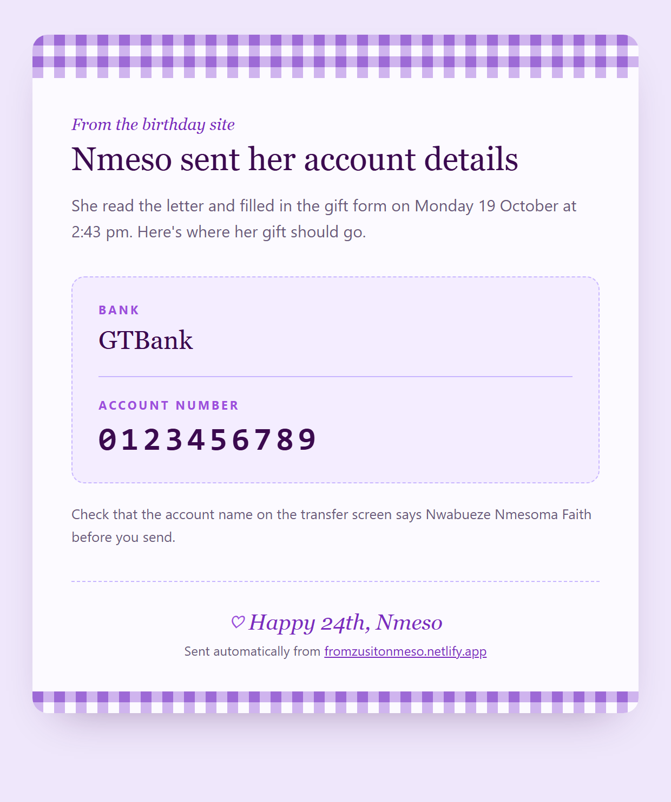

# From Zusi to Nmeso

A one-page birthday website Omozusi made for Nwabueze Nmesoma Faith (Nmeso) on her 24th birthday. She opens an envelope, reads a letter, and leaves her bank details so her gift can find her.

<p align="center">
  
  
  
  
</p>

## What happens on the page

1. **The card.** A note on a gingham tablecloth: "Hey Nmeso… Omozusi made you something." One tap opens it.
2. **The cake.** Bunting drops in and "Happy Birthday" writes itself out. *Blow the candles* turns the lights off, counts down while she makes a wish, then she actually blows: into the phone's microphone, or by holding the button. The flames lean and go out one by one in curls of smoke, the middle candle relights itself once ("nice try"), and when it's finally out the lights flicker back on to confetti. The mic only reads loudness and is switched off straight after.
3. **Twenty-four.** A huge outlined 24 fills with purple as you scroll.
4. **The evidence.** Photos and a video of her as taped polaroids, labelled Exhibit A to D, because she's about to be called to the Bar. Tap one to see it full size.
5. **The envelope.** Tap the wax seal: the flap folds back, the letter slides out, and the page carries you down to it.
6. **The letter.** Handwriting on ruled paper, revealed line by line, signed *Love, Omozusi*.
7. **The gift form.** Bank name and a 10-digit account number. On submit the form turns into a thank-you and the page throws confetti.

The look started from [an Instagram reel by _kanishka___](https://www.instagram.com/reel/DZz5hliPK2A/) (red scrapbook, cake, envelope) and was redrawn in purple, Nmeso's favourite colour.

## How it's built

The page has no framework and no build step.

- `site/` is plain HTML, CSS and JavaScript. Every drawing (cake, bunting, balloons, camera, envelope) is inline SVG, and the gingham and grid paper are CSS gradients.
- Motion comes from GSAP 3.12 with ScrollTrigger for the intro and scroll effects, canvas-confetti for the celebrations, and IntersectionObserver for the reveals. With reduced motion switched on, everything still works and simply appears.
- Fonts are Great Vibes, Fredericka the Great, Caveat and Poppins from Google Fonts.
- The form posts to a Netlify Function, `netlify/functions/send-gift.mjs`, which checks the details and emails them to Omozusi over Brevo SMTP using the template in `netlify/email/gift-email.mjs`:

<p align="center">
  
</p>

All of it runs on free tiers: Netlify for hosting and functions, and Brevo for sending the email (300 a day free).

## Project layout

```
site/                                the website Netlify publishes
  index.html
  styles.css
  script.js
  assets/                            photos and the video
netlify/
  functions/send-gift.mjs            receives the form and sends the email
  email/gift-email.mjs               HTML and plain-text versions of the email
scripts/preview-email.mjs            renders the email with sample data
docs/                                screenshots for this README
netlify.toml                         publish folder, functions folder, caching
DEPLOY.md                            setup on Netlify, step by step
```

## Run it locally

```bash
npm install
```

```bash
npm run serve
```

Then open http://localhost:5173. The serve script uses Python's built-in server; `npx serve site` works just as well.

Locally, the form skips the network call and goes straight to the thank-you, since the plain server can't run the function.

To look at the email without sending anything:

```bash
npm run email:preview
```

and open http://localhost:5173/email-preview.html.

## Deploying

See [DEPLOY.md](DEPLOY.md). In short: import this repo into Netlify and add `EMAIL_USER` and `EMAIL_PASS` (your Brevo SMTP login and key) as environment variables so the function can send the email. `.env.example` lists them.

## If you're borrowing this

The photos and video in `site/assets` are personal. Swap in your own, change the letter in `site/index.html`, and point `YOUR_EMAIL` at your inbox.

---

For Nmeso, on her 24th. From Zusi.
